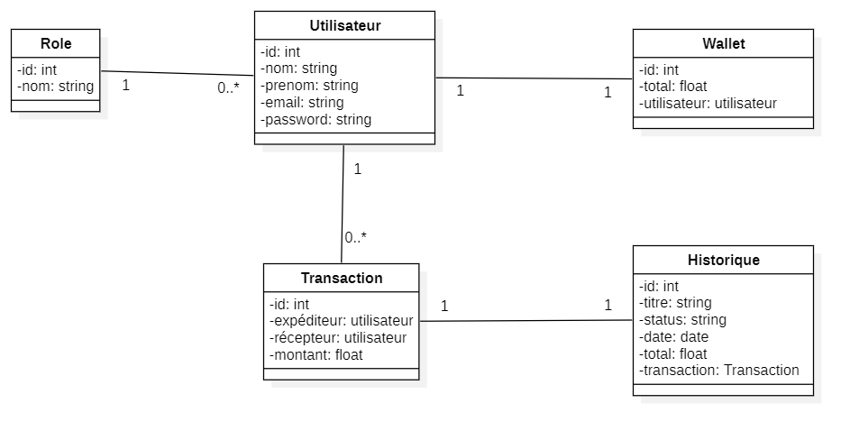

# YouMoney

Prototype Laravel de portefeuille numérique. Le dépôt documente le modèle de comptes et fournit le socle d’authentification.

[Schéma du portefeuille](https://github.com/Abdelhakim-Baalla/YouMoney/blob/main/Conception/Diagramme-des-classes-%28YouMoney%29.png)

